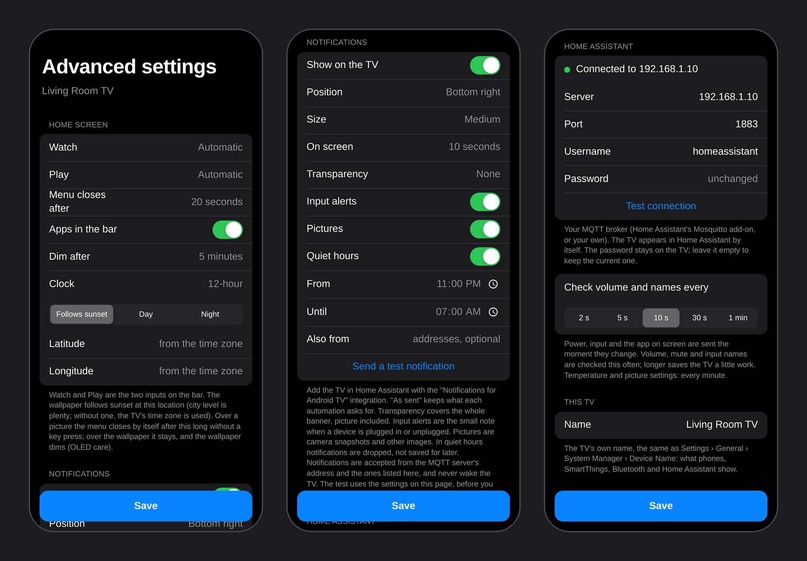

# SilentGlass-Tizen

**A calmer, more private Samsung TV: an Apple-style Home over your streaming box and console, Home Assistant built
in, and a Thread border router on your own network.**

Made for and tested on one Samsung **QN65S90D** (2024 OLED). Press Home and a glass bar fades in over whatever is
playing. Samsung's recognition, voice and ad services are off, the TV shows up in Home Assistant, and its Thread
radio joins your smart-home network.

> **Unofficial, at your own risk.** This changes the TV in ways Samsung doesn't support, using root access from a
> separate tool. Bricking is unlikely but possible, and most undo scripts haven't been tested on a TV yet. Read
> [Risks](#risks) first.


## Features

- **Home as an overlay.** Watch and Play switch to your streaming box and console; Inputs, Controls (picture, sound,
  Game Mode, sleep timer), Apps and Info share the same bar. No full-screen pages: the picture keeps playing.
- **Home Assistant.** Power, inputs, volume, picture and sound settings, and notifications (camera snapshots, the
  doorbell) over any input, without waking the TV. Set it up from your phone: Info > Advanced settings.
- **Thread border router.** The TV's built-in radio joins your existing Thread network (Home Assistant, Apple,
  Google) and keeps running in standby.
- **Privacy.** Content recognition (ACR), Bixby and the other voice assistants, ad targeting and Samsung's
  recommendations are off. Every HDMI input, eARC, Ambient/Art, AirPlay, power-on from your phone and IP remote
  control still work. What each Samsung service does: [Samsung service notes](docs/samsung-tizen-notes.md).


<p>
</p>



<sub>The TV can't capture its own video, so each screenshot is the TV's real UI layer over a still from *Big Buck
Bunny* (© Blender Foundation, CC BY 3.0). Addresses and codes are stand-ins.</sub>

More screenshots and how it works: [devices/s90d](devices/s90d/README.md). Guides:
[Home Assistant](devices/s90d/ha-bridge.md), [Thread](devices/s90d/thread-border-router.md).

## What it installs on the TV

**One Samsung app is taken over.** SilentGlass replaces the program inside Samsung's *Bixby promotion* app
(`com.samsung.tv.bixby-promotion`, a screen that advertises Bixby) and keeps the app's identity. Drawing over the
picture needs a permission only Samsung can grant (`window.priority.set`); that app already has it. The original
is backed up first. The rest of Bixby is disabled by the privacy phase, so only the name is left. Three TV settings
make SilentGlass the Home screen (`db/appfw/home_appid`, the main-operation Home handler) and send power-on to the
last input (`db/appfw/startup_appid`).

**Background services.** All are systemd *user* services of the TV's `owner` account; no system services are
changed. Each comes with its own optional phase.

| Service | What it does |
|---|---|
| `silentglass-ha` | Home Assistant bridge. Talks to your MQTT broker, takes notifications on port 7676, and serves the phone settings page on port 7680 only while the TV shows its QR code (10 minutes at most). |
| `quiet-recog-off` | Samsung restarts content recognition several times during boot. This checks every 3 s for the first 10 minutes, then every 30 s, and stops it. |
| `quiet-csfs-off` | Once a minute: if Samsung Home has been running unseen in the background for two checks, closes it (frees about 100 MB). Never while it's on screen. |
| `quiet-otbr-cpcd`, `-agent`, `-forward` | Thread: the radio daemon, the border router (a copy of Samsung's own `otbr-agent` with network permissions), and forwarding between your network and Thread. |
| `quiet-otbr-usbpower` | Keeps the USB port powered in standby (the Thread radio is a USB device). |
| `quiet-otbr-switch` | Starts or stops the Thread services when you flip the switch on the phone page or in Home Assistant. |

**One-time changes** (nothing keeps running): apps disabled in the TV's app registry, Multi View no longer preloaded
at boot, Samsung's automatic app and firmware updates turned off (batch G), and for Thread, the radio switched to
Samsung's own hub firmware image.

**Files:** `/opt/usr/share/silentglass-ha` (bridge), `/opt/usr/share/quiet-otbr` (Thread),
`/opt/usr/share/quiet-tizen-backups` (backups), and `silentglass-ha.conf` in the owner's config folder (your MQTT
login, readable only by the owner).

The `quiet-` names come from the project this started as; they're kept so existing installs keep working.

## Risks

No warranty (MIT). Samsung may refuse warranty service on a modified TV.

- **Never touched:** firmware, bootloader, partitions, read-only system files. That makes a TV that won't start
  unlikely.
- **What can break, and the fix:**
  - The app registry (apps won't launch): every script backs it up first and changes it in one checked step.
  - SilentGlass (Home does nothing; the TV still powers on to the last input): back to Samsung Home with
    `restore-stock-home.sh` (tested TV) or `recipes/restore-launcher.sh` (installs made with the recipes).
  - The Thread radio flash (Thread and SmartThings stop; the rest works): flash again with Samsung's own tool.
- **Every undo needs root** through [s90c-tools](https://github.com/invaliddayta/s90c-tools)' `tv-access`, which
  needs Developer Mode and a supported firmware. A firmware update can close that access, so batch G turns automatic
  updates off. That also means no security updates until you install them yourself.
- **Copy the backups off the TV.** Don't count on a factory reset as an undo; that hasn't been tested.
- **How the undo scripts were tested:** batch G and the Thread border router were run on the TV. All the others
  were run on a computer against copies of the tested TV's own files (app registry, settings, services, backups),
  one at a time and as one full chain back to stock: 45 disabled apps down to the one the Thread undo re-enables,
  and Samsung Home back. That found and fixed three that would have refused on the TV. It can't show how the TV
  behaves when apps and services restart, so those undos still haven't been run on a real TV.

## Install

[docs/install.md](docs/install.md): get the release files (or build them), install the launcher, make it Home,
then the optional bridge, Thread and privacy phases. Each phase has its own undo script.

Tested firmware: `T-PTMDAKUC-0090-REL-202605141701` on a QN65S90DAFXZA. Another model or firmware needs its own
inventory first: the same brand, year or Tizen version doesn't make it compatible.

With a coding agent:

> Read README.md, AGENTS.md and docs/agent-workflow.md. Work only on the TV I identify. Inventory it first and
> compare it with devices/s90d. Preserve the features I use, prepare a narrow inverse before changing anything,
> apply one phase at a time and report what the TV actually reads back.

## Repository

| Path | What |
|---|---|
| [launcher/src](launcher/src) | SilentGlass (.NET 6, Tizen NUI) |
| [devices/s90d](devices/s90d/README.md) | the tested TV: deploy scripts, privacy phases, boot services, Thread, Home Assistant bridge, [changelog](devices/s90d/changelog.md) |
| [recipes](recipes) | snapshot, first install and undo of the launcher |
| [docs](docs) | install guide, Samsung service notes, agent workflow |
| [tests](tests), [tools](tools) | offline tests and a simulated TV; build, release and mockup tools |

```sh
python3 -m unittest discover -s tests     # offline tests
python3 tools/build.py launcher            # needs the TV's framework assemblies (docs/install.md)
python3 tools/release.py VERSION           # release files from a clean checkout; builds are reproducible
```

## Credits

Started as a fork of [Quiet Tizen](https://github.com/jss8649/quiet-tizen) (MIT). Fonts: Inter (OFL). Details:
[NOTICE.md](NOTICE.md), [provenance](docs/provenance.md). Not affiliated with Samsung or any other company named
here. MIT license.
