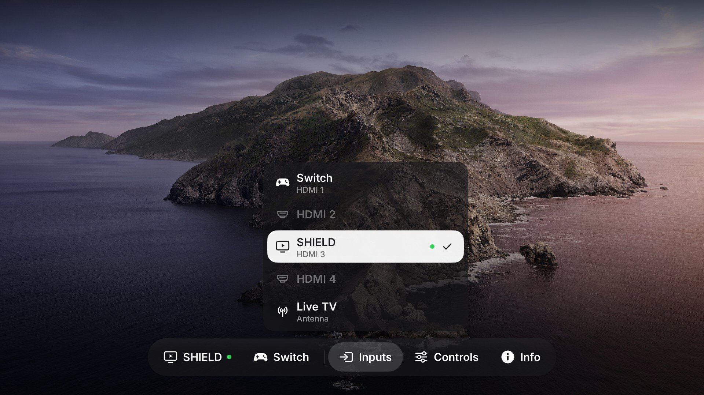
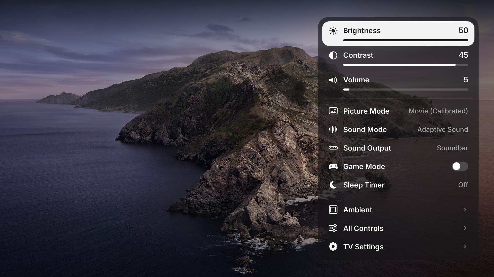

# SilentGlass-Tizen

**A calmer, more private Samsung Tizen TV with a Liquid Glass home screen - and a real Thread border router.**

SilentGlass-Tizen turns a Samsung **QN65S90D** (2024 OLED, Tizen) into a quiet display for the devices you actually
use. Its own launcher, **SilentGlass Home**, puts your streaming box and console first, plays the current input live
inside its card, and keeps the TV's apps one tab away. Underneath, it switches off the TV's recognition, voice,
advertising and recommendation services - each change reversible - and runs the TV's built-in Thread radio as a
border router on **your** smart-home network.


*SilentGlass Home on the S90D. The SHIELD is on screen, so its card is the wide one with live video (the TV's video
plane cannot be captured, so it shows black in screenshots).*

## What you get

### SilentGlass Home - the launcher

- **Home over the picture** (tvOS 26 style): press Home while something is playing and the picture is left alone -
  the TV's viewer stays in front and keeps playing. SilentGlass opens its own small window above it (a Samsung
  notification window, the way Vetro's dock works): a glass bar with the Watch and Play inputs, Inputs, Controls,
  Apps and Info. Inputs and Apps open as menus above the bar; Controls is a panel on the right, so brightness,
  contrast and picture mode can be judged on the picture while they change. Back or Home closes it. With nothing
  playing, Home is the full-screen launcher below.
- **Two big cards, no clutter**: *Watch* (e.g. an NVIDIA SHIELD) and *Play* (e.g. a Nintendo Switch). The input on
  screen gets the wide 16:9 card with its **live picture**; status dots instead of words. Made to be obvious at a
  glance for anyone in the house.
- **Liquid Glass** at **60 fps**: one GPU shader for every glass surface (lensing, specular rims, soft shadows), a
  day/night photo wallpaper that switches at local sunset, Apple continuous corners. Measured on the TV, not guessed.
- **Live inputs**: plug something in and its card, the Inputs sheet and a short toast follow - no polling.
- **Controls**: picture, sound, game mode, Pixel Shift, sleep timer, Bluetooth controllers and which input each card
  opens, as large tiles with their current values.
- **Info**: four status cards - Privacy, Network, Thread, This TV - and the launcher's settings: hide the Apps tab,
  live preview, dim when idle (OLED care), wallpaper mode and the Thread border router. Saved on the TV; they survive
  reboots.


*Home over the picture: the bar, captured from the TV's overlay window and composited over a stand-in photo (the video
plane itself cannot be captured).*





*Inputs opens above its bar item; Controls is a panel on the right, so the picture stays in view while it changes.*


### Privacy and cleanup

Measured, targeted and reversible, never a blanket "remove everything" list:

- **Content recognition (ACR)** and its databases off, with a boot watcher that keeps it off.
- **Voice assistants** - Bixby, Alexa, far-field and on-device voice, wake-word engines - disabled.
- **Advertising and recommendations** - targeted ads, TV Plus, voice "suggestions", AI companion, Samsung Home media
  rows - disabled; apps your streaming box replaces (Prime Video, Apple TV, the web browser) uninstalled.
- 39 apps disabled and 10 vendor services blocked in total; the Info page checks every one of them, every time.
- Samsung Home is closed while it sits unused in the background (~100 MB), and Multi View no longer preloads.
- Each phase ships with a first-run backup, a guarded inverse script and hash checks.

What still works: every HDMI input, eARC/soundbar, Ambient/Art mode, AirPlay, "power on with mobile", IP remote
control, network and Bluetooth settings. See [devices/s90d/README.md](devices/s90d/README.md) for the full list and
what was deliberately left alone.

### Home Assistant

The TV shows up in Home Assistant by itself (MQTT discovery): power, the input on screen as a selector that switches
inputs (by the TV's own input names, renamable from Home Assistant, with an HDMI-CEC resync for stale names), volume,
mute, brightness, contrast, picture and sound mode, sound output, sleep timer, game mode, the foreground app, the
Thread router's role and switch, Home and Ambient buttons, and chip temperature. A small owner service with a fixed set of commands; your broker credentials stay on the TV.
Guide: [devices/s90d/ha-bridge.md](devices/s90d/ha-bridge.md).

### Thread border router

The S90D has a Thread/Zigbee radio for Samsung's SmartThings hub, which can only create its *own* Thread network.
SilentGlass runs the radio with OpenThread as a standalone **border router that joins your existing network** - Home
Assistant, Apple Home, Google Home or any OTBR - or forms a new one if you have none. Matter-over-Thread devices get
one more router in the living room, with the SmartThings hub left off.

- One script to join (`otbr-join.sh`); a helper pulls Home Assistant's preferred network into a private file.
- Keeps running in standby (Samsung cuts the radio's power otherwise).
- On/off switch on the Info page; the choice holds across reboots.
- Uses whichever connection the TV is online through (tested wired); no Samsung system files changed; full uninstall.

Guide: [devices/s90d/thread-border-router.md](devices/s90d/thread-border-router.md).

## Tested hardware

| TV | Firmware | Track |
|---|---|---|
| Samsung **QN65S90DAFXZA** (S90D, 2024 OLED) | `T-PTMDAKUC-0090-REL-202605141701` | SilentGlass: launcher, privacy, Thread - [devices/s90d](devices/s90d/README.md) |
| Samsung UN75U8000FFXZA (U8000F, 2025) | `T-KSU2EFAKUC-0090-1300.9` | inherited Quiet Tizen toolkit - [case study](docs/u8000f-case-study.md) |

Everything here was done on one owner's TV. Another model or firmware needs its own inventory first: a matching brand,
year or Tizen version is not enough to establish compatibility.

## How it changes the TV

- **Owner-authorized, local and reversible.** Administrative commands run as root through a separately reviewed
  per-command helper; that does not remove Samsung's SMACK sandbox or firmware protections, and nothing here tries to.
- **No TV firmware is flashed** and no bootloader, partition or SDB key is touched. The one exception is the Thread
  radio's application image, switched between images Samsung ships on the TV, with Samsung's own flasher and only
  with the owner's approval.
- **The launcher replaces a stock app in place** (Samsung's Bixby promotion app) and is set as the Home handler;
  power-on still goes to the last input. Restore scripts put the original back.
- **Persistence uses the owner's own systemd user units** - no system services are modified.

## Getting started

Give the repository to your coding agent:

> Read README.md, AGENTS.md and docs/10-agent-workflow.md. Work only on the TV I identify. Inventory it first and
> compare it with the tested profile in devices/s90d. Preserve the features I use, prepare a narrow inverse before
> changing anything, apply one phase at a time and report what the TV actually reads back - separately for reboot,
> standby and recovery.

Then, in order: [agent walkthrough](docs/10-agent-workflow.md) -> [access and persistence](docs/11-access-and-persistence.md)
-> [S90D record](devices/s90d/README.md) -> [recovery](docs/09-recovery.md).

## Repository map

| Path | What |
|---|---|
| [launcher/](launcher/src) | SilentGlass Home (.NET 6 / Tizen NUI): `Home*.cs` partials, `HomeLogic.cs` (pure, unit-tested), assets |
| [devices/s90d/](devices/s90d/README.md) | the S90D record: launcher deploy scripts, privacy and cleanup phases, boot units, Thread border router, Pi-side drift check, benchmarks |
| [docs/](docs) | agent workflow, access/persistence, upstream notes, and the inherited U8000F guides (01-09) |
| [tests/](tests) | offline tests: launcher source rules, Thread recipe integrity, catalog and logic checks in C# |
| [tools/](tools) | build (`tools/build.py launcher`), wallpaper builder, artwork and cleanup planners |
| profiles/, recipes/, evidence/ | the U8000F track inherited from Quiet Tizen |

## Development

```sh
python3 -m unittest discover -s tests            # offline: source rules, Thread recipe, scripts
python3 tools/build.py launcher --framework .local/tv-framework   # needs the TV's private reference assemblies
dotnet run --project tests/CatalogTests.csproj -c Release -- .local/package/quiet-home/apps.json
```

The launcher builds with the .NET 6 SDK against reference assemblies copied from your own TV (never redistributed).
Deploys go through versioned `update-vN.sh` / `restore-v(N-1).sh` pairs that verify every file.

## Lineage and credits

SilentGlass-Tizen began as a fork of [Quiet Tizen](https://github.com/jss8649/quiet-tizen) (commit `cf518d7`, MIT),
whose U8000F launcher, reversible-cleanup method and agent workflow it builds on; that track is kept in
[docs/u8000f-case-study.md](docs/u8000f-case-study.md). New here: the S90D port, the SilentGlass Home launcher and its
Liquid Glass renderer, live input previews, the wider privacy phases with boot watchers, the Thread border router
and the on-TV settings.

Also: the original visual approach adapts [Free My TV](https://github.com/simbasjungles/free-my-tv); the temporary
access route comes from [samsung-tv-root](https://github.com/chris-ritsen/samsung-tv-root). Fonts (Inter, OFL) and
symbols (Material Symbols, Apache 2.0) keep their licenses. Exact commits and terms: [NOTICE.md](NOTICE.md),
[provenance](docs/provenance.md).

Not affiliated with Samsung, NVIDIA, Nintendo, Apple, Google, the Thread Group or any streaming service. Code is
MIT-licensed ([LICENSE](LICENSE)).

> **Internal names.** On the TV, files keep their original identifiers (`quiet-home-*` state and settings files,
> `quiet-otbr-*` units, `/opt/usr/share/quiet-tizen-backups/`) so existing installs, backups and restore scripts keep
> working. Only the visible name changed.
