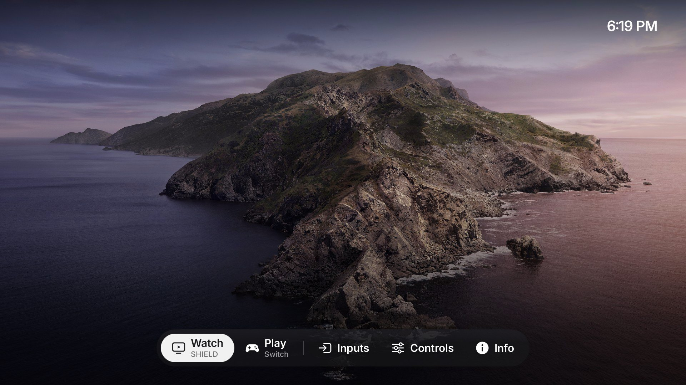

# SilentGlass-Tizen

**A calmer, more private Samsung TV: an Apple-style overlay for your streaming box and console, Home Assistant
built in, and a real Thread border router.**

SilentGlass turns a Samsung **QN65S90D** (2024 OLED, Tizen) into a quiet display for the devices you actually use.
Press Home and a glass bar fades in over whatever is playing - the picture keeps running underneath. Underneath
that, the TV's recognition, voice and advertising services are switched off (each change reversible), the TV shows
up in Home Assistant with notifications on any input, and its built-in Thread radio joins **your** smart-home network.

> **Unofficial and at your own risk.** This modifies a Samsung TV in ways Samsung doesn't support, through root
> access from a separate tool. The risk of bricking it is low but not zero, and most undo scripts haven't been run on
> a TV yet. Read [Risks and recovery](#risks-and-recovery) before installing anything.


*The bar over the picture, captured from the TV's overlay window and composited over a stand-in photo (the TV's video
plane itself can't be captured).*

## What you get

### SilentGlass - Home as an overlay

No full-screen pages: everything is a bar, a menu or a panel over the picture (tvOS 26 style).

- **The bar**: *Watch* and *Play* - your streaming box and console, with the device's name underneath and a green
  dot on the one showing - then Inputs, Controls, Apps and Info. Home again or Back closes it.
- **Inputs** opens above its bar item: every input by the TV's own name for it, a checkmark on the current one.
- **Apps** floats the TV's apps above the bar (or hide them from the bar entirely).
- **Controls** is a panel on the right, so the picture stays in view while you change brightness, contrast, volume,
  picture and sound mode, sound output, Game Mode (Automatic / Always / Never), sleep timer and Pixel Shift; plus
  Ambient, Bluetooth, Network and the TV's own settings.
- **Info** is a near-opaque panel: privacy, network, Thread, Home Assistant and TV status, then SilentGlass's
  settings - which input Watch and Play open, apps in the bar, dim when idle, wallpaper, notifications - and
  **Advanced settings**, which opens the phone page.
- **With nothing to draw over** (no signal, or Home from Ambient or an app), a day/night wallpaper and the time sit
  behind the bar; after 5 idle minutes it fades to a dim drifting clock (OLED care).
- Built for anyone in the house: visual, few words, no "On/Off" jargon, 60 fps, nothing truncated.




*Overlay windows captured on the TV and composited over the wallpaper (the video plane can't be captured). The last one
is a full capture of the backdrop with the bar.*

### Home Assistant

- The TV appears by itself (MQTT discovery): power, the input on screen as a selector (by the TV's input names,
  renamable from Home Assistant), volume, mute, brightness, contrast, picture and sound mode, sound output, sleep
  timer, Game Mode, the app in front, the Thread router, Home and Ambient buttons, chip temperature.
- **Notifications on any input**: add the TV with Home Assistant's *Notifications for Android TV* integration and
  notifications (Frigate snapshots, the doorbell) appear as a banner over whatever is on screen - SHIELD, a console,
  an app - without taking the remote. They never wake the TV.
- **Advanced settings on your phone**: Info > Advanced settings shows a QR code. Scan it, enter the code on screen, and fill in
  the home screen (Watch/Play inputs, Apps, dimming, wallpaper), notifications, the Thread border router, your MQTT
  broker (with a Test button) and the TV's name. Info shows Home Assistant's status. Nothing to type with the remote;
  the settings stay on the TV.


*The phone setup sheet (address, code and QR code replaced with stand-in values).*

Guide: [devices/s90d/ha-bridge.md](devices/s90d/ha-bridge.md).

### Thread border router

The S90D has a Thread radio for Samsung's SmartThings hub, which can only create its *own* network. SilentGlass runs
the radio with OpenThread as a standalone **border router that joins your existing network** - Home Assistant,
Apple Home, Google Home or any OTBR - with the SmartThings hub left off. Join from the phone setup page (it can read
Home Assistant's preferred network for you); it keeps running in standby, with an on/off switch on the phone page and in Home Assistant.
Guide: [devices/s90d/thread-border-router.md](devices/s90d/thread-border-router.md).

### Privacy

Targeted and reversible, never a blanket "remove everything" list:

- **Content recognition (ACR)** and its databases off, with a boot watcher that keeps it off.
- **Voice assistants** (Bixby, Alexa, wake-word engines) disabled.
- **Advertising and recommendations** (targeted ads, TV Plus, AI companion, Samsung Home media rows) disabled.
- Info checks every disabled app and blocked service, every time.
- Each phase ships with a first-run backup, a guarded inverse script and hash checks.

Still working: every HDMI input, eARC/soundbar, Ambient/Art, AirPlay, "power on with mobile", IP remote control,
network and Bluetooth settings. What each Samsung service does and what disabling it does and doesn't mean:
[Tizen notes](docs/samsung-tizen-notes.md).

## Tested hardware

| TV | Firmware |
|---|---|
| Samsung **QN65S90DAFXZA** (S90D, 2024 OLED) | `T-PTMDAKUC-0090-REL-202605141701` |

Everything here was done on one owner's TV. Another model or firmware needs its own inventory first: a matching
brand, year or Tizen version is not enough to establish compatibility.

## How it changes the TV

- **Owner-authorized, local, and designed to be reversible** (see [Risks and recovery](#risks-and-recovery) for what
  has actually been undone on a TV). Administrative commands run as root through a separately reviewed
  per-command helper ([s90c-tools](https://github.com/invaliddayta/s90c-tools), not bundled); that does not remove
  Samsung's SMACK sandbox or firmware protections, and nothing here tries to.
- **No TV firmware is flashed** and no bootloader, partition or SDB key is touched. The one exception is the Thread
  radio's application image, switched between images Samsung ships on the TV, with Samsung's own flasher and only
  with the owner's approval.
- **The launcher replaces a stock app in place** (Samsung's Bixby promotion app) and is set as the Home handler;
  power-on still goes to the last input. `recipes/restore-launcher.sh` is meant to put the original back (not yet
  run on a TV).
- **Persistence uses the owner's own systemd user units** - no system services are modified.

## Risks and recovery

No warranty (MIT). Samsung may refuse support or warranty service for a modified TV.

**What is never touched:** the TV's firmware, bootloader, partitions and read-only system files. Changes go to the
writable data area: the app registry, settings keys, files in an app container, stop markers and the owner's own
systemd units. A hard brick (a TV that won't start) would need one of the untouched parts to break, so it is
unlikely. A **soft brick** (the TV starts, but something important doesn't work) is possible:

| What could go wrong | What you'd see | How it's recovered |
|---|---|---|
| The app registry (`/opt/dbspace/.pkgmgr_parser.db`) is damaged by a privacy batch or the launcher install | apps don't launch | each script copies the registry first, edits it in one transaction and checks it; copy the backup back (root) |
| SilentGlass fails to start | the TV powers on to the last input as usual, but Home does nothing | `recipes/restore-launcher.sh` (root) |
| The Thread radio flash fails | Thread, Zigbee and Samsung's SmartThings hub don't work; the rest of the TV does | flash again with the same Samsung tool (its bootloader isn't touched) |
| A disabled Samsung service turns out to be needed | one TV feature misbehaves | that batch's restore script |

**Recovery needs root.** Every undo runs as root through [s90c-tools](https://github.com/invaliddayta/s90c-tools)'
`tv-access`, which needs Developer Mode and a firmware build that tool supports. Keep both working:

- **Batch G turns automatic firmware updates off,** because an update can close that access. You then get no
  security updates unless you install them yourself, and a manual update can still close it. Check s90c-tools before
  updating.
- **Backups are kept on the TV** (`/opt/usr/share/quiet-tizen-backups/`). Copy them to another machine: a backup on the
  TV doesn't help if its storage is wiped.
- **Don't count on a factory reset as an undo.** Whether it restores the replaced app and the Home setting hasn't been
  tested.

**Which undo scripts have actually been run on a TV** (all on the one tested TV):

- Run and verified: batch G (apply, restore, apply) and the Thread border router (full uninstall and reinstall).
- Written but not yet run: `restore-launcher.sh` (back to Samsung Home), `restore-settings-bridge.sh`,
  `ha-bridge-restore.sh`, the privacy batch restores (C to F2, multiview, Prime), the boot-unit restores and the
  launcher rollback (`restore-v32a.sh`). Treat these as untested. Test one on your own TV before relying on it.

## Getting started

- Installing: [docs/install.md](docs/install.md) - build, launcher, Home, settings keys, the Home Assistant bridge,
  then the optional Thread and privacy phases.
- With a coding agent:

  > Read README.md, AGENTS.md and docs/agent-workflow.md. Work only on the TV I identify. Inventory it first and
  > compare it with devices/s90d. Preserve the features I use, prepare a narrow inverse before changing anything,
  > apply one phase at a time and report what the TV actually reads back - separately for reboot, standby and
  > recovery.

## Repository map

| Path | What |
|---|---|
| [launcher/src](launcher/src) | SilentGlass (.NET 6 / Tizen NUI): `SilentGlass.cs` (app, Home, keys), `Overlay.cs` (bar), `Menus.cs`, `Panels.cs` (Controls, Info), `Setup.cs`, `Notice.cs`, `Backdrop.cs`, `Tv.cs` (TV APIs), `Ui.cs` (look); `Logic.cs` and `Qr.cs` are NUI-free and unit-tested |
| [devices/s90d](devices/s90d/README.md) | the device record: deploy scripts, privacy phases, boot units, Thread border router, Home Assistant bridge, Pi-side drift check |
| [recipes](recipes) | first-install and restore scripts (launcher, settings keys, snapshots, stop markers) |
| [docs](docs) | install guide, Tizen notes, agent workflow, access and persistence, upstream notes |
| [tests](tests) | offline tests: launcher and bridge source rules, the HA notification client, the phone setup page, Thread recipes, C# logic |
| [tools](tools) | build, symbol and wallpaper generators, UI mockups, bridge installer, artwork fetcher |

## Development

```sh
python3 -m unittest discover -s tests            # offline checks (the setup-page test needs the bridge built)
python3 tools/build.py launcher --framework .local/tv-framework   # needs the TV's own framework assemblies
dotnet run --project tests/CatalogTests.csproj -c Release -- launcher/assets/apps.json
python3 tools/overlay_mockup.py .local/mock      # render the UI on a desktop before touching the TV
```

Deploys go through versioned `update-vN.sh` / `restore-v(N-1).sh` pairs that verify every file. Builds are
reproducible (SDK pinned in `global.json`); `python3 tools/release.py VERSION` builds the release files from a clean
checkout and refuses if the committed bridge installer doesn't match its source.

## Lineage and credits

SilentGlass-Tizen began as a fork of [Quiet Tizen](https://github.com/jss8649/quiet-tizen) (commit `cf518d7`, MIT),
whose reversible-cleanup method, install recipes and agent workflow it builds on; its findings about Samsung's
services live on in [Tizen notes](docs/samsung-tizen-notes.md). Fonts (Inter, OFL) keep their license. Exact commits
and terms: [NOTICE.md](NOTICE.md), [provenance](docs/provenance.md).

Not affiliated with Samsung, NVIDIA, Nintendo, Apple, Google, the Thread Group or any streaming service. Code is
MIT-licensed ([LICENSE](LICENSE)).

> **Internal names.** On the TV, files keep their original identifiers (`quiet-home-*` state and settings files,
> `quiet-otbr-*` units, `/opt/usr/share/quiet-tizen-backups/`) so existing installs, backups and restore scripts keep
> working. Only the visible name changed.
