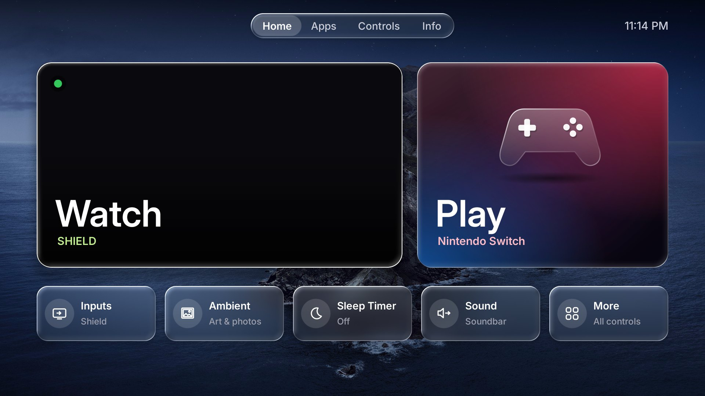

# Samsung QN65S90DAFXZA (S90D, 2024 OLED)

SilentGlass-Tizen's tested TV. Owner setup: **SHIELD TV Pro** (via the Q990D soundbar, HDMI 3) is the main
device, **Nintendo Switch** on HDMI 1; the TV's own apps are backups. The phases below carry backups,
guarded inverses and hash checks. Recorded reboot checks apply to their tested phase/version;
newer edits still need their own acceptance rather than inheriting a blanket reboot guarantee.

- Firmware: `T-PTMDAKUC-0090-REL-202605141701` (system build string `TIZEN-TRUNK2025-PontusM-OSU-2024-HOTFIX-RELEASE_20260514.3`)
- Admin access: per-command UID-0 (root) sessions through the separately reviewed external
  `s90c-tools` `tv-access` helper, not the U8000F-gated `tools/tv.py` bundled here.
  Scripts in this device workflow are fed to `/bin/sh` on **stdin**; direct unsigned-script
  execution is restricted by UEP. The helper automates acquisition per command; it does not
  install permanent root or remove SMACK restrictions.

## Agent reading order and evidence scope

Start with the [agent walkthrough](../../docs/10-agent-workflow.md), then the relevant
scripts and inverse below. Read [access/persistence](../../docs/11-access-and-persistence.md)
and [upstream notes](../../docs/12-upstream-notes.md) before proposing another boot mechanism.
The [original access guide](../../docs/02-access.md) documents the U8000F track, not
an S90D installation command. Phase scripts and benchmark records are dated evidence,
not proof that every historical phase remains active or passed every boot scenario.
Re-read current device state and exact hashes before acting; never run every saved
installer merely because it exists.

## SilentGlass Home (v26a)

Native NUI app installed in place of `com.samsung.tv.bixby-promotion` and set as the Home handler
(`db/appfw/home_appid`); power-on still goes to the last input (`startup_appid=org.tizen.tv-viewer`).
Version history and measurements: [changelog.md](changelog.md). On the TV it keeps its original file names
(`quiet-home-*`), so earlier installs and restore scripts keep working.

*Home (v22a, night wallpaper). The SHIELD is on screen, so Watch is the wide 16:9 card and its live video plays
inside it; the TV's video plane cannot be captured, so it shows black in screenshots. Tab bar with the Apps tab shown
(the default).*

*Info (v25b): status cards on top, SilentGlass Home's settings below (here with the Apps tab hidden and Dim when idle off).
LAN address blurred.*

### Pages

- **Home**: *Watch* (SHIELD) and *Play* (Switch) hero cards; the current input's card is wide and shows live video.
  Below: Inputs (sheet of HDMI 1-4 + Live TV), Ambient, Sleep Timer, Sound, More (opens Controls).
- **Apps** (can be hidden from Info): the TV's own apps and Samsung Home - backups, since the SHIELD has the real ones.
- **Controls**: 5x3 tiles for picture, sound and game settings, Watch/Play input choice, Pixel Shift, Network,
  Bluetooth controllers and Samsung's full settings menu.
- **Info**: four status cards - *Privacy* (vendor blocks and disabled apps still in place), *Network* (link, address,
  speed, live rate with a small sparkline), *Thread* (border router role, home reach, traffic) and *This TV* (uptime,
  model, software, memory, processor) - then the settings below. Only the settings take focus; values refresh every
  2 s while the page is visible.

### Settings

On the TV (Info page; saved in the app's data directory as `quiet-home-prefs.txt`, so they survive reboots; a file
from an older version loads with the defaults for anything new):

| Tile | Default | Does |
|---|---|---|
| Apps tab | on | hidden = the tab bar shows Home, Controls, Info and Left/Right skip the Apps spot |
| Live preview | on | video of the current input inside its hero card |
| Dim when idle | on | OLED care: fade to black with a drifting dim clock after 5 idle minutes |
| Wallpaper | Auto | Auto (switch at local sunrise/sunset) / Day / Night; only with the photo wallpaper installed |
| Thread border router | on | starts/stops the border router units ([thread-border-router.md](thread-border-router.md) section 5); only where installed |
| Watch Input / Play Input (Controls) | Automatic | which HDMI input each hero card opens; never both the same |

For development and measurement only: `/tmp/quiet-home-live.conf` (key=value lines, read at start; cleared on
reboot): `squircle=0|1`, `vsync=N` (render every Nth vsync, 1 = 60 fps), `herofade=1`, `wall=photo|gradient`,
`wallmode=auto|day|night` (only while the Wallpaper tile is Auto), `lat=`/`lon=` (sunset location, default
New York), `bench=N` (redraw every frame for N s), `enabled=0` (no preview), `scrim=0` (no band behind the words).

The photo wallpaper (macOS Catalina Day/Night) is Apple artwork and not in git: build it with
`tools/make_wallpapers.py DAY.jpg NIGHT.jpg`; without it SilentGlass Home uses the gradient wallpaper. (The screenshots
above show it.)

### How it works

- **Home**: two hero cards - *Watch* (SHIELD) and *Play* (Switch) - plus Inputs, Ambient, Sleep Timer, Sound, More.
  Heroes bind to the input chosen on Controls (*Watch Input* / *Play Input*) or, on Automatic, to the inputs the TV
  names `Shield` / `Switch` (fallback HDMI 3 / HDMI 1), so re-cabling needs no change.
- **Live inputs**: `libsource-api` `register_sourcelist_changed_callback` + vconf `memory/system/source_type`
  notifications drive the *On now* / *Unplugged* badges, the Inputs sheet and a short "connected" toast. No polling.
- **Status dots, no words**: green = the current input has a picture, grey = no signal
  (`memory/tv-viewer/mainscreen_signal_state`, debounced 800 ms), empty ring = unplugged; other inputs get no dot
  (CEC reports power per TV port only, port 3 answers as the soundbar; the Switch dock is not on CEC). The Inputs
  list marks the selected input with a separate checkmark.
- **Hero cards follow the input on screen**: Watch stays left and Play right, but the current input's card is the
  wide one at exactly 16:9 (996x560), so its preview is uncropped; the other is 684 wide. Each artwork exists at
  both widths (`feature-{watch,play}-{wide,narrow}.svg`). The 100px hero word needs a 150px-tall label (116 drew "...").
- **Live preview**: the current input plays inside its hero card when it has a signal. FLUX `VideoCanvasView` +
  `TVWindowControlAPI` (Channel List's mini-TV recipe). Lessons from getting it right on the S90D:
  - the video plane does not follow scale/position animations, so the live card does not grow/lift on focus;
  - set `wm.tvs.win.use.tvs=1` + window transparency once and keep it until Home is paused - toggling it per
    preview made the TV re-sync the input, flapping the signal flag in a rebuild loop;
  - the canvas must sit directly above the card artwork (below the words), with a soft gradient for legibility;
  - crop, don't squash: the canvas (hole) is the card, but `DisableAutoUpdateVideoGeometry` +
    `ForceUpdateVideoGeometry(x,y,w,h)` give the plane a covering 16:9 rect; overflow hides behind the opaque UI and
    the HW clips the off-screen part with a matching source crop (seen: src 3423x2160 -> dst 887x560);
  - the TV can leave the main video muted while tv-viewer is backgrounded (black but correctly placed plane after
    SilentGlass Home restarted mid-preview): `IAVControl.MuteVideo(0)` on attach, as Channel List does.
  Verify without looking: `enlightenment_info -hwc_wins` lists the `VD` plane's `dst_pos` (e.g. `1100x0560+0100+0170`
  for the Watch card); `enlightenment_info -dump topvwins DIR` dumps the UI layer (the hole is alpha 0; video is not
  captured). Tunables: see *Settings* below.
- **Inputs sheet**: HDMI 1-4 + Live TV by the TV's edit name > detected name > port; *On now* / *Not connected*.
  `powerState` is deliberately not shown: on this TV the on-screen SHIELD reports Off (devices behind the soundbar,
  empty CEC device list).
- **Ambient**: one press to `org.tizen.art-app`. The Art app grabs Home and always opens Samsung Home
  (`ReturnType.Home` -> CSFS, hard-coded); SilentGlass Home watches `memory/appfw/current_fullscreen_appid` and brings
  itself back on that one hand-off.

Source: `launcher/src/Home*.cs` (partials: Controls, Inputs, Info, Idle, State). Latency rules are enforced by
tests: no IPC/file I/O on the key path, incremental focus restyling, chrome built once, coalesced state writes.
Measured on the TV: key handling avg ~20 ms, source-list read 1.2 ms, warm page build ~60 ms.

Deploy: `launcher-deploy/update-vN.sh` (refuses unless the installed DLL is the previous version; keeps SMACK labels;
verifies every file) and `restore-v(N-1).sh`. Build with `python3 tools/build.py launcher` + TV framework DLLs.

## Device changes (device/)

| Area | What | Inverse |
|---|---|---|
| privacy/ | Phase B: `app_disable` on ACR, voice/Bixby/Alexa stacks, TV Plus (registry SQL + `AppMetadata` helper reload) | restore.sh / restore.sql |
| cleanup/batchc | ad targeting (`targeted-ad-service`), voice leftovers (`utterance-recommender-core`, `AICompanionAgent`, `aov-dashboard`) | batchc-restore.sh |
| cleanup/prime* | Prime Video boot metadata removed, companion disabled, `disable.appbooting` (ineffective, kept) | prime-restore.sh, prime-noboot-restore.sh |
| boot-units/quiet-recog-off | owner user-systemd watcher stopping content recognition (later boot targets restart it) | recog-boot-restore.sh |
| cleanup/batchd | SHIELD does everything: Prime Video, Apple TV, web browser **uninstalled**; TV YouTube and Samsung Home media rows disabled (cast to SHIELD's Chromecast; AirPlay unaffected); janitor unit removed | batchd-restore.sh (store apps: reinstall from Samsung Apps) |
| boot-units/quiet-prime-off | *removed by batch D* - janitor that closed Prime/Apple TV/browser in the background | batchd-restore.sh |
| thread-border-router/ | standalone Thread border router that joins your existing network (or forms one: `otbr-join.sh`): owner user units run the hub `cpcd` + a capability copy of Samsung's `otbr-agent` on the default-route interface, hub stays off; radio on the hub image; SilentGlass Home Info switch ([thread-border-router.md](thread-border-router.md)) | otbr-restore.sh (radio back to stock: ncp-updater + stZigbeeRcp-mfg); switch upgrade: otbr-switch-restore.sh |

Install the units with `*-install.sh`, then the latest `*-update*.sh` (janitor: update5 then update5c). UEP also blocks `sh -n file`; check syntax with `sh -n < file`. User units live in
`/opt/usr/home/owner/.config/systemd/user` (label `User::Home`) and are driven with
`DBUS_SESSION_BUS_ADDRESS=kernel:path=/sys/fs/kdbus/5001-user/bus XDG_RUNTIME_DIR=/run/user/5001 systemctl --user`.

Not done on purpose: TV YouTube (`cobalt-yt`) is relaunched by litewebappservice within seconds when closed;
Samsung Home (`csfs`, ~100-120 MB) and its media rows (`home.media`, ~70-150 MB) are relaunched within ~1 min (measured), so closing them only burns CPU;
SmartThings/OTBR components are kept (the TV is a Thread border router on the home network, see
[thread-border-router.md](thread-border-router.md)); Art/Ambient services kept.

## Pi side (pi/)

`s90d_drift_check.py` + `s90d_expected.json` (set `tv`): weekly read-only check of firmware, Home/startup apps,
vendor markers, disabled apps, SilentGlass Home DLL hash, boot units and recognition. Prints nothing when all is well
(cron watchdog pattern); reports only after 3 consecutive unreachable runs.

`thread_dataset.py`: saves Home Assistant's preferred Thread dataset to a private file for `otbr-join.sh`.

`probe_forwarding.py`: one-packet proof that LAN -> Thread traffic is routed through the TV (see thread-border-router.md).

## Findings worth knowing

- Settings API takes short menuitem ids from `settings-datafw/jsons/tv/*.json`; long catalog paths do not resolve.
- `get_source_list()` returns a malloc'd JSON string - bind it as `string` so the marshaller frees it.
- Google DNS `8.8.8.8` is a connmand fallback; a router "force local DNS" rule redirects it, no TV change needed.
- Soundbar input flips (TV eARC <-> HDMI 1) when leaving/entering SHIELD are CEC "active source" changes caused by
  the soundbar pass-through wiring; SHIELD straight into the TV (soundbar on eARC only) avoids them.
