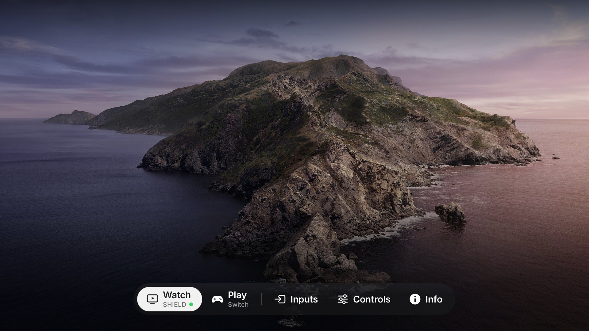
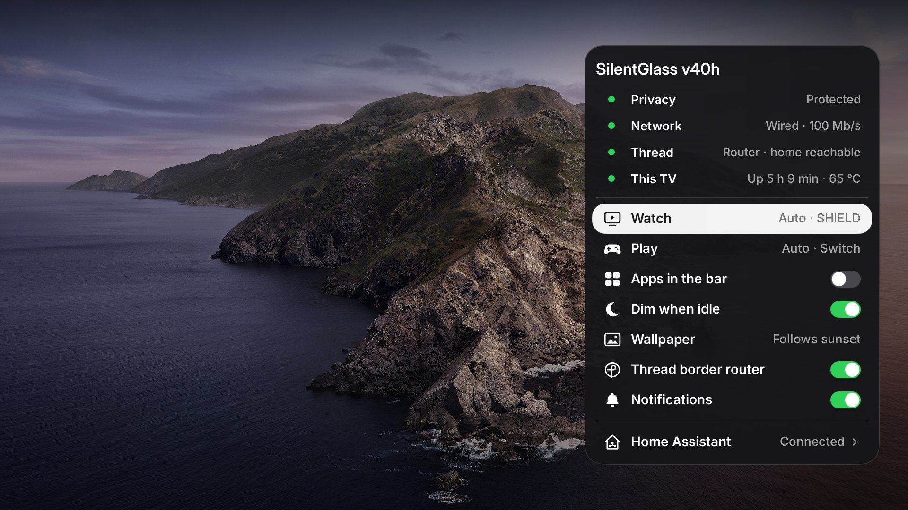

# Samsung QN65S90DAFXZA (S90D, 2024 OLED)

SilentGlass-Tizen's tested TV. Owner setup: **SHIELD TV Pro** (via the Q990D soundbar, HDMI 3) is the main
device, **Nintendo Switch** on HDMI 1; the TV's own apps are backups. The phases below carry backups,
guarded inverses and hash checks. Recorded reboot checks apply to their tested phase/version;
newer edits still need their own acceptance rather than inheriting a blanket reboot guarantee.

- Firmware: `T-PTMDAKUC-0090-REL-202605141701` (system build string `TIZEN-TRUNK2025-PontusM-OSU-2024-HOTFIX-RELEASE_20260514.3`)
- Admin access: per-command UID-0 (root) sessions through the separately reviewed external
  `s90c-tools` `tv-access` helper (not bundled).
  Scripts in this device workflow are fed to `/bin/sh` on **stdin**; direct unsigned-script
  execution is restricted by UEP. The helper automates acquisition per command; it does not
  install permanent root or remove SMACK restrictions.

## Agent reading order and evidence scope

Start with the [agent walkthrough](../../docs/agent-workflow.md), then the relevant
scripts and inverse below. Read [access/persistence](../../docs/access-and-persistence.md)
and [upstream notes](../../docs/upstream-notes.md) before proposing another boot mechanism.
Phase scripts and benchmark records are dated evidence,
not proof that every historical phase remains active or passed every boot scenario.
Re-read current device state and exact hashes before acting; never run every saved
installer merely because it exists.

## SilentGlass (v40i)

Native NUI app installed in place of `com.samsung.tv.bixby-promotion` and set as the Home handler
(`db/appfw/home_appid`); power-on still goes to the last input (`startup_appid=org.tizen.tv-viewer`).
Version history: [changelog.md](changelog.md). On the TV it keeps its original file names (`quiet-home-*` resources,
`quiet-otbr-*` units), so earlier installs and restore scripts keep working.

### Overlays only

There are no full-screen pages. Everything interactive lives in one partial, transparent window of type Notification
at level Top ([`Overlay.cs`](../../launcher/src/Overlay.cs)) above the TV viewer, which stays in front and keeps
playing; nothing touches the video plane.

- **Bar** (bottom): **Watch** and **Play** with the device each opens underneath (the TV's input name; a green dot
  on the one with a picture), Inputs, Controls, Apps (unless hidden) and Info. Left/Right move, Select (or Up on a
  menu item) opens. Over a picture, Home toggles it; Back closes it; it steps aside after 45 idle seconds.
- **Inputs** (menu above its bar item): every input by the TV's name, a checkmark on the current one.
- **Apps** (above the bar): the TV's apps and Samsung Home, as artwork; they are backups - the SHIELD has the real ones.
- **Controls** (panel on the right, replacing the bar; translucent so the picture shows the change): Brightness,
  Contrast, Volume (Select mutes); Picture Mode, Sound Mode, Sound Output, Game Mode (Automatic / Always / Never -
  the TV's single three-way `game-mode-auto`), Sleep Timer, Pixel Shift; Ambient, Bluetooth, Network, TV Settings.
- **Info** (panel on the right, near-opaque): Privacy, Network, Thread and This TV status (refreshed every 3 s), then
  the settings below, then **Home Assistant** (phone setup sheet: QR code + 6-digit code; see
  [ha-bridge.md](ha-bridge.md)).
- **Backdrop**: with nothing to draw over (no signal, or Home from Ambient or an app) the app's own window shows the
  wallpaper and time behind the bar; Back there goes to the last input. After 5 idle minutes it fades to a dim
  drifting clock (OLED care). It is hidden whenever anything else is in front, so it never flashes over the picture.
- **Notifications and toasts** have their own non-focusable window ([`Notice.cs`](../../launcher/src/Notice.cs)).
- Look: dark translucent glass with a hairline edge and a soft dimming gradient (video can't be blurred), white
  capsule focus, SF Symbols-style icons (`tools/make_symbols.py`). `tools/overlay_mockup.py OUTDIR` renders the same
  screens 1:1 on the Pi before anything goes to the TV.

### Settings

On the TV (Info; saved as `silentglass-prefs.txt` in the app's data directory, so they survive reboots; an older
`quiet-home-prefs.txt` is read once and replaced):

| Setting | Default | Does |
|---|---|---|
| Watch / Play | Automatic | which input each bar item opens: Automatic = the input the TV names `Shield` / `Switch` (else HDMI 3 / HDMI 1), or HDMI 1-4; never both the same |
| Apps in the bar | on | off = no Apps item (the Apps menu is gone; Samsung Home stays reachable from Controls > TV Settings) |
| Dim when idle | on | OLED care on the backdrop |
| Wallpaper | Auto | Auto (switch at local sunrise/sunset; location from the phone setup page) / Day / Night; only with the photo wallpaper installed |
| Thread border router | on | starts/stops the border router units ([thread-border-router.md](thread-border-router.md)); only where installed |
| Notifications | on | banners from Home Assistant ([ha-bridge.md](ha-bridge.md)) and the input plugged/unplugged toasts |

The photo wallpaper (macOS Catalina Day/Night) is Apple artwork and not in git: build it with
`tools/make_wallpapers.py DAY.jpg NIGHT.jpg`; without it the gradient wallpaper is used.

### How it works

- **Inputs** are pushed by the TV, no polling: `libsource-api` `register_sourcelist_changed_callback` and vconf
  notifications on `memory/system/source_type`, `memory/tv-viewer/mainscreen_signal_state` (settled for 800 ms) and
  `memory/appfw/current_fullscreen_appid`. Names: edit name > detected name > port. `powerState` is ignored: behind
  the soundbar the SHIELD reports Off.
- **Ambient**: the Art app always hands Home to Samsung Home (hard-coded); SilentGlass watches the foreground app and
  brings itself back on that one hand-off.
- **Cold start**: the TV's launch placeholder holds the remote's keys until the app's main window has been shown once,
  so that window starts shown (black, empty) and Home hides it as the bar opens. The TV also pauses the app whenever
  only the overlay is up; a pause never closes the overlay - another app coming to the front does.
- **Launch extras** (from the bridge, QuickLaunch or Home Assistant): `sg_open=controls|info|apps|inputs|setup`,
  `sg_source=<type>` (switch input), `sg_notice=1` (start hidden for a notification).
- **State file** `/tmp/silentglass-state.txt` (coalesced, never on the key path): version, what is showing
  (`ui=`, `backdrop=`, `fg=`), focus, key timing, inputs, settings values. The bridge reads it to report the app on
  screen.
- Source: [`launcher/src`](../../launcher/src). Latency rules are enforced by tests: no IPC or file I/O on the key
  path, native callbacks posted to the UI thread, interrupted animations land on their end state.

Deploy: `launcher-deploy/update-vN.sh` (refuses unless the installed DLL is the previous version; keeps SMACK labels;
verifies every file) and `restore-v(N-1).sh`. A first install: [docs/install.md](../../docs/install.md).

## Device changes (device/)

| Area | What | Inverse |
|---|---|---|
| privacy/ | Phase B: `app_disable` on ACR, voice/Bixby/Alexa stacks, TV Plus (registry SQL + `AppMetadata` helper reload) | restore.sh / restore.sql |
| cleanup/batchc | ad targeting (`targeted-ad-service`), voice leftovers (`utterance-recommender-core`, `AICompanionAgent`, `aov-dashboard`) | batchc-restore.sh |
| cleanup/prime* | Prime Video boot metadata removed, companion disabled, `disable.appbooting` (ineffective, kept) | prime-restore.sh, prime-noboot-restore.sh |
| boot-units/quiet-recog-off | owner user-systemd watcher stopping content recognition (later boot targets restart it) | recog-boot-restore.sh |
| cleanup/batchd | SHIELD does everything: Prime Video, Apple TV, web browser **uninstalled**; TV YouTube and Samsung Home media rows disabled (cast to SHIELD's Chromecast; AirPlay unaffected); janitor unit removed | batchd-restore.sh (store apps: reinstall from Samsung Apps) |
| cleanup/batchf | Prime Video, Apple TV and the web browser came back ~3.5 h after batch D uninstalled them (Samsung country preloads are reinstalled); kept installed but **disabled** instead, which sticks. Inverse `batchf-restore.sh` |
| cleanup/batche | content-info feed for ACR (`cis`, `cis-api-service-app`), usage analytics (`samsung-analytics`), voice leftovers (`multi-assistant-service`, always-on `aov-service`, voice instant/onboarding, three Bixby apps), ad players (`adplatform.ADPlayer`, `adplayer`, `ad-web-framework`); chosen from Vetro's catalog and checked on this TV. Not included: `coba.adagent` (Samsung Home loads it), `content-grab-service` / `nvision-analysis-dbmgr` (may feed picture processing / Ambient) | batche-restore.sh |
| cleanup/multiview | Multi View no longer preloads at boot (marker that Samsung's own unit checks: `ConditionPathExists=!.../disable_preloading`); opens on demand, cold | multiview-restore.sh |
| boot-units/quiet-csfs-off | owner watcher: while SilentGlass Home is the Home app, closes Samsung Home (`csfs`, ~100 MB) after it has sat in the background for two one-minute checks; never while it is on screen. Identity by SMACK label | csfs-off-restore.sh |
| ha-bridge | Home Assistant bridge over MQTT discovery: power, input (selectable, TV-named), per-port rename + CEC name resync, volume/mute, brightness/contrast, picture/sound mode, sound output, sleep timer, game mode, app, Thread role and switch, Home/Ambient buttons, temperature, memory. Owner service, fixed command list. See [ha-bridge.md](ha-bridge.md) | ha-bridge-restore.sh |
| boot-units/quiet-prime-off | *removed by batch D* - janitor that closed Prime/Apple TV/browser in the background | batchd-restore.sh |
| thread-border-router/ | standalone Thread border router that joins your existing network (or forms one: `otbr-join.sh`): owner user units run the hub `cpcd` + a capability copy of Samsung's `otbr-agent` on the default-route interface, hub stays off; radio on the hub image; SilentGlass Home Info switch ([thread-border-router.md](thread-border-router.md)) | otbr-restore.sh (radio back to stock: ncp-updater + stZigbeeRcp-mfg); switch upgrade: otbr-switch-restore.sh |

Install the units with `*-install.sh`, then the latest `*-update*.sh` (janitor: update5 then update5c). UEP also blocks `sh -n file`; check syntax with `sh -n < file`. User units live in
`/opt/usr/home/owner/.config/systemd/user` (label `User::Home`) and are driven with
`DBUS_SESSION_BUS_ADDRESS=kernel:path=/sys/fs/kdbus/5001-user/bus XDG_RUNTIME_DIR=/run/user/5001 systemctl --user`.

Measured after a reboot with batch E, Multi View and the csfs watcher: MemAvailable ~780-835 MB (TV on), against
~600-630 MB before. Two Samsung diagnostic-log hosts still resolve (`fc.samsungcloud.tv`, `www.samsungrm.net`, used by
`emergencyLogTransmitter`, a root system service that cannot be stopped from the owner session): block them in your DNS.
Already off on this TV and worth checking on others: firmware auto-update (`db/menu/support/softwareupdate/autoupdate`)
and Smart Hub autostart (`db/menu/smart_hub/ontvsetting/auto_start`).

Not done on purpose: TV YouTube (`cobalt-yt`) is relaunched by litewebappservice within seconds when closed;
Samsung Home (`csfs`, ~100-120 MB) and its media rows (`home.media`, ~70-150 MB) are relaunched within ~1 min (measured), so closing them only burns CPU;
SmartThings/OTBR components are kept (the TV is a Thread border router on the home network, see
[thread-border-router.md](thread-border-router.md)); Art/Ambient services kept.

## Pi side (pi/)

`s90d_drift_check.py` + `s90d_expected.json` (set `tv`): weekly read-only check of firmware, Home/startup apps,
vendor markers, disabled apps, SilentGlass Home DLL hash, boot units and recognition. Prints nothing when all is well
(cron watchdog pattern); reports only after 3 consecutive unreachable runs.

`thread_dataset.py`: saves Home Assistant's preferred Thread dataset to a private file for `otbr-join.sh`.

`probe_forwarding.py`: one-packet proof that LAN -> Thread traffic is routed through the TV (see thread-border-router.md).

## Findings worth knowing

- Settings API takes short menuitem ids from `settings-datafw/jsons/tv/*.json`; long catalog paths do not resolve.
- `get_source_list()` returns a malloc'd JSON string - bind it as `string` so the marshaller frees it.
- Google DNS `8.8.8.8` is a connmand fallback; a router "force local DNS" rule redirects it, no TV change needed.
- Soundbar input flips (TV eARC <-> HDMI 1) when leaving/entering SHIELD are CEC "active source" changes caused by
  the soundbar pass-through wiring; SHIELD straight into the TV (soundbar on eARC only) avoids them.
