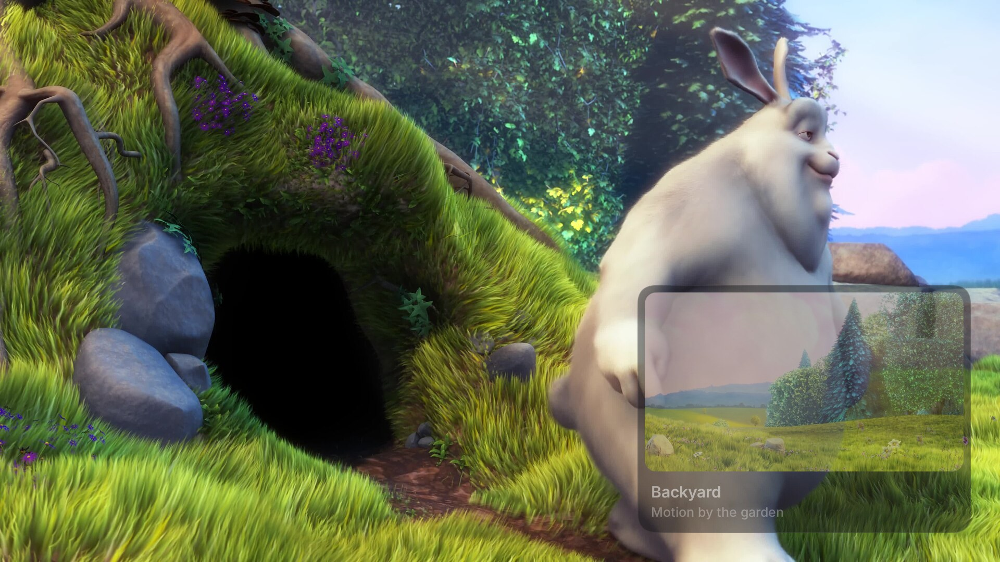
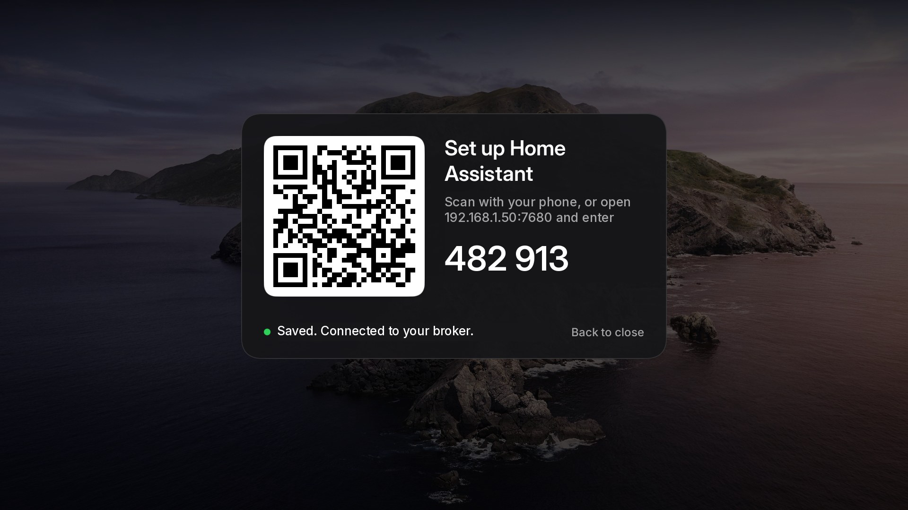

# Home Assistant bridge

`silentglass-ha` adds the TV to Home Assistant as one MQTT device, and shows Home Assistant notifications on the
TV. It's a small .NET service (about 20 MB of memory) that runs as the TV's normal user, not root.

## What Home Assistant gets

| Entity | What |
|---|---|
| `switch.<tv>_power` | on / standby |
| `select.<tv>_input` | the input on screen, by the TV's names; pick one to switch |
| `text.<tv>_hdmi_N_name` | rename an input everywhere (TV menu, SilentGlass, Home Assistant) |
| `button.<tv>_resync_input_names` | fix stale HDMI-CEC device names |
| `number.<tv>_volume`, `switch.<tv>_mute` | volume (also drives the soundbar) |
| `number.<tv>_brightness`, `_contrast` | picture (0-50) |
| `select.<tv>_picture_mode`, `_sound_mode`, `_sound_output` | only the modes the TV offers right now |
| `select.<tv>_sleep_timer`, `_game_mode` | Game Mode: Automatic / Always / Never |
| `switch.<tv>_notifications` | banners on the TV |
| `sensor.<tv>_app` | what's on screen: an input's name, Ambient, Samsung Home… |
| `switch.<tv>_thread_border_router`, `sensor.<tv>_thread_role` | where Thread is installed |
| `button.<tv>_home`, `_ambient` | open SilentGlass or Ambient |
| `sensor.<tv>_chip_temperature`, `_free_memory` | diagnostics |

The device shows unavailable only while the TV is unplugged or rebooting.

## Notifications

Banners over any input, with a picture, title and message.

**Set up:** add Home Assistant's built-in **Notifications for Android TV / Fire TV** integration with the TV's
address. Existing automations and blueprints work unchanged, through `notify.send_message`, `notify.<name>` or a
notify group.

**Options:**
- `image`: a URL or file (JPEG, PNG, WebP, or an animated GIF);
- `duration`: 3-60 s;
- `position`: bottom-right, bottom-left, top-right, top-left or center;
- `fontsize`: small, medium, large or max;
- `transparency`: 0, 25 or 50%, for the whole card, picture included.

`color` and `interrupt` are ignored.

**Rules:**
- **Never wakes the TV.** Banners are dropped in standby, in Ambient and in quiet hours.
- **A newer banner replaces the old one.** With the same title it updates in place. So you can send a camera alert at
  once, then send it again with a better clip. Frigate's `review_preview.gif` animates.
- **Only trusted senders.** Banners come only from the MQTT broker's machine, plus any addresses in `notify_from`.
- **The remote stays with the picture.** The banner never takes the remote, and the video is never touched.
- **Your settings win.** The phone page's position, size, time on screen and transparency override what each
  notification asks for.

## Set up from a phone

On the TV, open **Info › Advanced settings**. Scan the QR code and enter the 6-digit code; the QR never carries the
code. The page has:

- **Home screen:** Watch/Play inputs, menu close time, Apps in the bar, wallpaper dim and clock, wallpaper and its
  location;
- **Notifications:** on/off, input alerts, position, size, time, transparency, pictures, quiet hours, a test button;
- **Thread border router:** on/off, and its network: keep it, import Home Assistant's, or paste a dataset;
- **Home Assistant:** MQTT server and login, with **Test connection**. The password is never sent back;
- **This TV:** the TV's name, as Home Assistant, phones and Bluetooth see it.

The page works only while the sheet is open, for 10 minutes at most. It's plain HTTP on your network, and the code
keeps everyone else out.

## Install

1. With the bundle copied to the TV as `quiet-tizen/package.tar.gz`: `/bin/sh -s -- bridge < device/install.sh`.
   Later updates come with the launcher ([updating](../../docs/install.md#updating)).
2. Set it up from a phone (above). To set it up by hand instead, copy `silentglass-ha.conf.example` to
   `silentglass-ha.conf` in the owner's `.config`.
3. The TV appears in Home Assistant under Settings › Devices.

- The MQTT login is stored only on the TV, readable only by its owner.
- A broker user limited to `silentglass/#` and `homeassistant/+/silentglass_s90d/#` is the tidy choice.
- **Remove:** `ha-bridge-restore.sh`, then delete the device in Home Assistant.

## How it works (for developers)

- **Updates:** power, input and app changes come from vconf notifications (`memory/pm/state`,
  `memory/eden/source/current_source`, `memory/appfw/current_fullscreen_appid`). Volume and names are checked every
  10 s (the `update=` setting), and temperature and picture settings every minute. Only changes are published, plus
  a full refresh every 5 min.
- **Power:** pressed through the bridge's own `/dev/uinput` device, which can only send KEY_POWER. Samsung's remote
  server sends keys the same way, and the owner user may open it. What doesn't work:
  - `device_power_set_state`, `ChangePowerState` and `changestate` return -22 even as root;
  - `input_keyevent` is root-only;
  - the remote WebSocket ignores 127.0.0.1.
- **Notifications:** the bridge speaks the *Notifications for Android TV* protocol on port 7676 (at most 12 MB per
  request).
  - It writes `notice.json` and the picture into SilentGlass's data folder, and SilentGlass shows them in its own
    window, which never takes focus.
  - If SilentGlass isn't running, the bridge starts it hidden with `sg_notice=1`, but only over an input. Over
    another app the banner is dropped.
  - `tests/test_s90d_notice.py` runs Home Assistant's own client library against it.
- **Input names:**
  - Each port has the name you set and the name its device announced over HDMI-CEC.
  - The TV keeps a stale announced name after the device is gone, and a device behind a soundbar shows as the
    soundbar.
  - Resync runs a 20 s CEC search, then puts back your own name, which the TV resets.
  - The names live in activity index -2.
- **Commands** are a fixed list with no shell. To switch inputs it launches SilentGlass with `sg_source`.
- **Topics:** `silentglass/s90d/...`. Discovery is under `homeassistant/<component>/silentglass_s90d/...`.
- **Log:** `/run/user/5001/silentglass-ha.log`.
